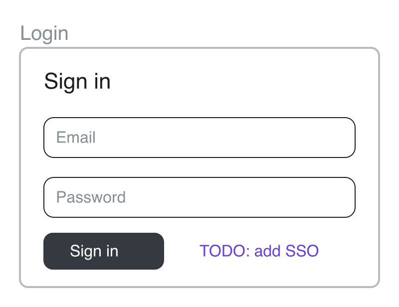

# excalidraw skill

An agent skill that lets Claude Code read Excalidraw drawings. It lists the screens on a board, dumps their text, and renders any screen or region to a PNG the agent can look at.

Obsidian stores a drawing as LZ-String-compressed JSON inside an `.excalidraw.md` file, so `grep` and `Read` show an unreadable blob. This skill decodes the drawing with a single Python script (standard library only) and gives the agent three views of the same board: a numbered list of screens, the labels in reading order, and a picture.



## Requirements

- Python 3 (standard library only).
- `rsvg-convert` (`brew install librsvg`) or ImageMagick `magick` for PNG output. Without either, `render` still writes an SVG.

## Installation

For all your projects, clone the repository into your user skills directory:

```bash
git clone https://github.com/jannismain/excalidraw-skill.git ~/.claude/skills/excalidraw
```

For one project only, clone it into that project's skills directory instead:

```bash
git clone https://github.com/jannismain/excalidraw-skill.git .claude/skills/excalidraw
```

Update later with `git pull` inside the cloned directory. Claude Code picks the skill up in new sessions. Check with `/skills`, which should list `excalidraw`.

## Usage

### Let the agent use it

The skill triggers when a task mentions a wireframe, mockup, diagram or sketch stored in an Excalidraw file. Ask for the outcome and name the file:

```text
Build the "Login" screen from board.excalidraw.md as a React component.
```

```text
What does the checkout flow in docs/flow.excalidraw show? List the steps in order.
```

The agent lists the screens, renders the one you named, reads its labels, and works from both.

### Run it yourself

All commands take an `.excalidraw.md` or `.excalidraw` file. The examples use the sample in `examples/`.

List the screens on a board. A screen is an Excalidraw frame. When the drawing has no frames, any rectangle of at least 600×400 counts (`--min-size WxH` changes that), and the title is the text just above it.

```console
$ python3 -I scripts/excalidraw.py list examples/login.excalidraw
11 elements, 2 screens (frames)

 n  id        x      y      w     h   label
 1  f1      0      0    360  240   Login
 2  f2    440      0    360  240   Dashboard
```

Dump the text of one screen, grouped into rows. `@x` is the offset from the screen's left edge and `y` the offset from its top. A `[#color]` tag marks text that is not the default black, which is often an annotation rather than UI.

```console
$ python3 -I scripts/excalidraw.py texts examples/login.excalidraw -s Login
y=  20 | @24: Sign in
y=  80 | @36: Email [#868e96]
y= 140 | @36: Password [#868e96]
y= 194 | @50: Sign in [#ffffff]  ||  @180: TODO: add SSO [#6741d9]
```

Render a screen to a PNG. The command prints the path, and the agent then reads the image.

```console
$ python3 -I scripts/excalidraw.py render examples/login.excalidraw -s Login -o login.png
login.png
```

Select a screen with `-s` by number, id prefix, or any text from its title or content. A query that matches several screens exits and lists the candidates. To render an area that is not a screen, such as a component library, pass `-r x0,y0,x1,y1` in drawing coordinates. `list --sections` prints the large headings with their coordinates.

| Command | Purpose | Useful options |
| --- | --- | --- |
| `list` | Number every screen with its title | `--sections`, `--min-size` |
| `texts` | Labels of a screen or region, in rows | `--json` |
| `render` | PNG (or SVG) of a screen or region | `-o`, `--width`, `--pad`, `--svg-only` |

Output goes to a temporary directory unless you pass `-o`, so the drawing's folder stays untouched.

## Limits

- The render approximates Excalidraw. Fonts differ and the hand-drawn roughness is gone. Structure, labels and positions are reliable. Colours and exact spacing are indicative.
- The tool reads the file on disk, so unsaved changes in an open editor are not visible.
- Embedded images resolve from the drawing's folder, where Obsidian stores them. A missing image renders as a grey box with a red outline.
